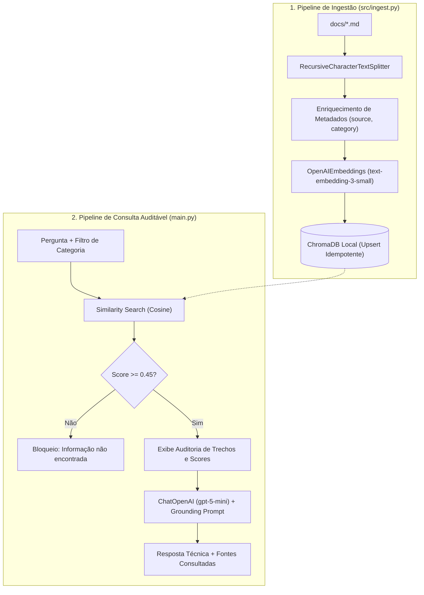

# IT Runbooks RAG Assistant (CLI)


Assistente de linha de comando (CLI) baseado em arquitetura **RAG (Retrieval-Augmented Generation)** para consulta de runbooks operacionais e políticas internas de TI. O sistema combina busca vetorial por similaridade de cosseno, filtragem por metadados e travas de relevância para responder dúvidas técnicas com citação obrigatória das fontes e mitigação de alucinações.

---

## Arquitetura do Sistema



---

## Decisões Técnicas Implementadas

| Componente | Implementação | Objetivo Técnico |
| :--- | :--- | :--- |
| **Chunking Semântico** | `RecursiveCharacterTextSplitter` (`450` chars, `80` overlap) | Preserva títulos Markdown e parágrafos inteiros sem cortar comandos técnicos ao meio. |
| **Filtragem por Metadados** | Filtro dinâmico por `category` (`infra`, `redes`, `seguranca`) | Reduz o espaço de busca vetorial e aumenta a precisão em bases multi-domínio. |
| **Trava Anti-Alucinação** | Corte mínimo de relevância (`SIMILARITY_THRESHOLD = 0.45`) | Interrompe o fluxo antes de acionar o LLM quando a pergunta foge do escopo dos manuais. |
| **Auditabilidade** | Log de recuperação exibido no terminal antes da resposta | Permite inspecionar exatamente quais arquivos e *scores* embasaram a resposta da IA. |
| **Ingestão Idempotente** | IDs determinísticos por arquivo e índice de *chunk* | Reexecutar a ingestão atualiza os vetores modificados sem duplicar registros no ChromaDB. |

---

## Estrutura do Projeto

```text
rag-it-runbooks-cli/
├── docs/                           # Base de conhecimento em Markdown
│   ├── infra_servidores.md
│   ├── redes_vpn.md
│   └── seguranca_acessos.md
├── src/
│   ├── __init__.py
│   ├── config.py                   # Variáveis de ambiente e parâmetros do RAG
│   ├── ingest.py                   # Pipeline de leitura, chunking e indexação
│   ├── retriever.py                # Busca semântica com filtro e threshold
│   └── generator.py                # Formatação de contexto e geração controlada
├── main.py                         # Interface interativa no terminal (CLI)
├── .env.example                    # Modelo de credenciais
├── .gitignore
├── requirements.txt
└── README.md
```

---

## Como Executar Localmente

1. **Clone o repositório e crie o ambiente virtual:**
   ```bash
   git clone [https://github.com/SEU-USUARIO/rag-it-runbooks-cli.git](https://github.com/SEU-USUARIO/rag-it-runbooks-cli.git)
   cd rag-it-runbooks-cli
   python -m venv venv
   ```

2. **Ative o ambiente virtual e instale as dependências:**
   ```bash
   # Windows (PowerShell)
   .\venv\Scripts\Activate.ps1

   # Linux / macOS
   source venv/bin/activate

   pip install -r requirements.txt
   ```

3. **Configure a chave da OpenAI:**
   ```bash
   cp .env.example .env
   # Edite o arquivo .env e insira sua OPENAI_API_KEY
   ```

4. **Execute a indexação dos documentos e inicie o assistente:**
   ```bash
   python -m src.ingest
   python main.py
   ```